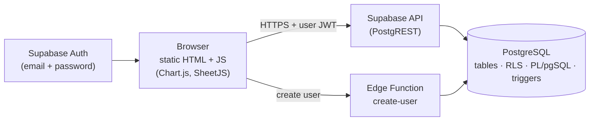
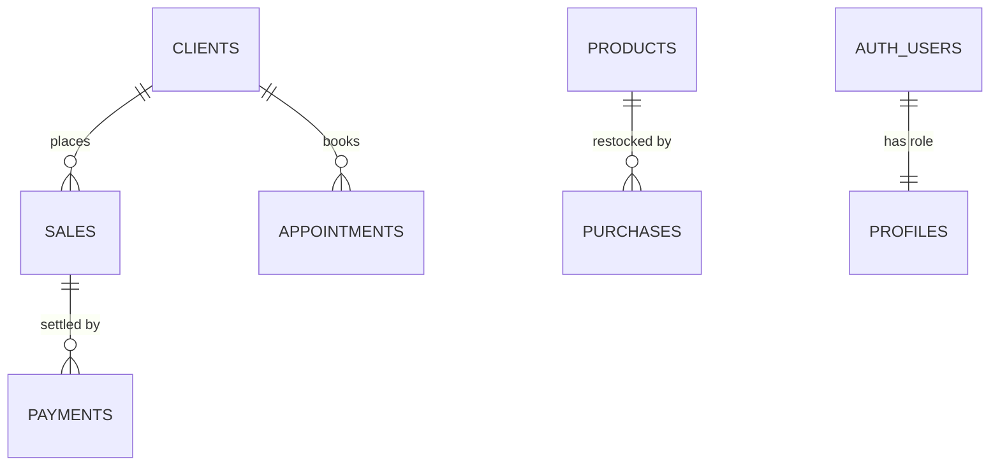

# ZecaMotos: Shop Management System

A data-first management system for a motorcycle repair shop in Eldorado do Sul, RS (Brazil): sales and service orders, inventory with weighted-average costing, receivables, scheduling and an analytics layer. Built around a PostgreSQL schema, with business rules in the database and a lightweight web client on top.

> **About this repository:** this is a **sanitized public mirror** of a system running in production for a real business. It contains **no API keys, no project URLs and no customer data**. Set your own `SUPABASE_URL` and `SUPABASE_KEY` at the top of the script in `index.html` to run it.

## Highlights

- **Relational core in PostgreSQL**: 9 tables, constraints, indexes, sequences and triggers, defined in a single idempotent script (`database/schema.sql`).
- **Business rules live in the database**: sales, cancellations, credit payments and stock purchases are PL/pgSQL functions exposed as RPC endpoints. A sale, its stock decrement and its audit record commit in **one ACID transaction**, and stock can never go negative.
- **Row Level Security**: owner and staff roles are enforced at the data layer, not only in the UI.
- **Audit trail**: trigger-based log of who changed what and when.
- **Analytics-ready**: revenue, profit, margin, ABC curve, stock coverage and a simple sales projection, plus one-click full export (Excel and JSON).
- **API-based web client**: static HTML/JS, no build step, works on desktop, tablet and phone.

## Architecture



The browser only ever holds the public (publishable) key plus the logged-in user's token. What each user can do is decided by Row Level Security policies and function checks inside the database.

## Data model



| Table | Purpose |
|---|---|
| `products` | Catalog with code, category, weighted-average cost, sale price, stock, low-stock threshold, soft delete |
| `services` | Service catalog and prices |
| `clients` | Customers, motorcycle (model) and plate, plus optional marketing data (address, gender, age range) |
| `sales` | Sales and service orders: receipt number, odometer, payment method, status, line items snapshot |
| `payments` | Receipts of credit ("fiado") sales |
| `purchases` | Stock purchases with supplier |
| `appointments` | Service calendar |
| `profiles` | Access level (`admin` or `funcionario`) per Supabase Auth user |
| `audit_log` | Change history |

## Design decisions

- **Line items as JSONB snapshots.** `sales.items` stores name, quantity, price and cost at the moment of the sale. Historical revenue and profit never change when prices or costs are edited later. Items reference products by id on purpose, without a foreign key.
- **Weighted-average cost.** Every purchase recomputes the product cost: `(stock × cost + qty × unit_cost) / (stock + qty)`. Example: 10 units at R$ 5.00 plus 10 units at R$ 7.00 gives an average cost of R$ 6.00.
- **Soft deletes.** Products, services and clients are archived (`active = false`), never deleted. Sales are cancelled, not removed, and cancelling returns the stock.
- **Writes through functions only.** `sales`, `payments`, `purchases` and `audit_log` have no direct INSERT/UPDATE/DELETE grants for users. The only way in is the `SECURITY DEFINER` functions, which validate everything.
- **Least privilege for staff.** Staff users cannot read cost data: they read a view (`products_pub`) without cost columns, always sell at catalog prices, and never get cost data back from the sale function.
- **Generated codes and normalized data.** Triggers create product and service codes (`P0001`, `S0001`) and store license plates in upper case.

### API surface

Besides the table endpoints generated by PostgREST:

| RPC | Who | What it does |
|---|---|---|
| `create_sale` | admin, staff | Creates a sale, decrements stock and writes the audit log in one transaction |
| `cancel_sale` | admin | Cancels a sale and returns the stock |
| `receive_payment` | admin | Registers a (partial) payment of a credit sale |
| `add_debt` / `edit_debt` | admin | Registers or edits an old debt that did not come from a sale |
| `register_purchase` | admin | Adds stock and recomputes the weighted-average cost |

A Supabase Edge Function (`create-user`) creates users and checks that the caller is an admin, so the service key never reaches the browser.

## Access levels

| Capability | Admin | Staff |
|---|:---:|:---:|
| Sell (workshop and counter sales) | ✅ | ✅ (catalog prices only) |
| Scheduling | ✅ | ✅ |
| Register clients | ✅ | ✅ |
| See costs, profit, sales history | ✅ | ❌ |
| Products, services, purchases, receivables | ✅ | ❌ |
| Analytics, audit log, users, data export | ✅ | ❌ |

## Analytics layer

- Revenue, profit, number of sales and average ticket, filtered by year, month, category, item and sale type.
- Eight selectable charts (revenue over time, top sellers, revenue and profit by category, payment methods, workshop vs counter, customers by age range and gender).
- **Stock and projections:**
  - Sell-everything scenario: stock value at cost and at list price, potential profit and margin.
  - Run-rate scenario: repeats the sales of the last N days over the next N days, capped by available stock.
  - ABC curve (A = 80% of revenue, B = next 15%, C = last 5%), stock coverage in days, reorder and dead-stock flags, and rankings of the products that earn the most and the least.

## Repository structure

```
index.html                              # web client (single file)
database/schema.sql                     # complete database: tables, functions, triggers, RLS
supabase/functions/create-user/index.ts # Edge Function that creates users (admin only)
```

## Getting started

1. Create a [Supabase](https://supabase.com) project.
2. In the SQL Editor, run `database/schema.sql` on the empty project. It is safe to run again.
3. In **Authentication > Users**, create your first user, then run the commented block at the end of `schema.sql` to make it an admin.
4. In **Authentication**, turn off *Allow new users to sign up*.
5. Deploy `supabase/functions/create-user/index.ts` as an Edge Function named `create-user`.
6. Set `SUPABASE_URL` and `SUPABASE_KEY` (publishable key) at the top of the script in `index.html`.
7. Host `index.html` on any static host. To print the service order with your logo, add a `logo.png` next to it.

## Notes

- User-facing text and error messages are in Portuguese, because the system is used by a Brazilian shop.
- The printed service order is a simple receipt, **not a fiscal document**.
- Projections are deliberately simple: they assume the same sales pace and ignore seasonality and promotions.
